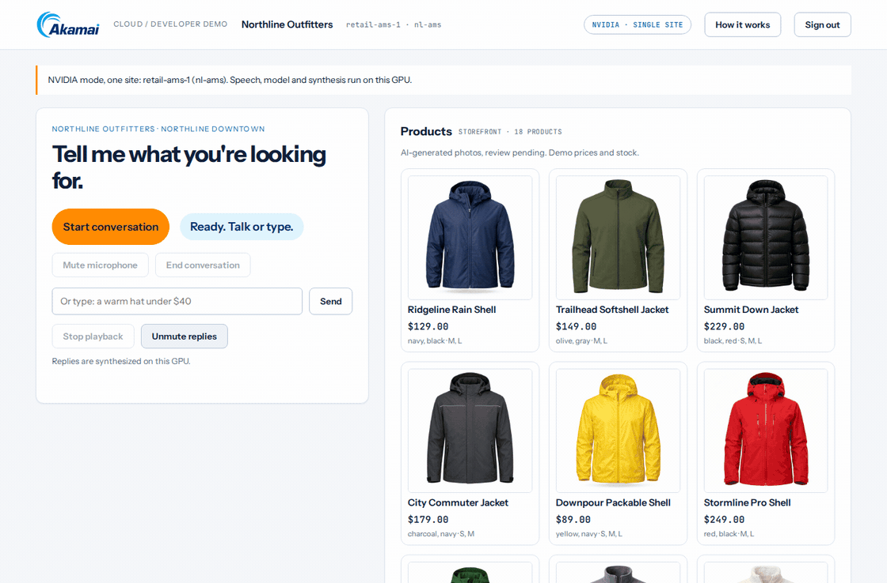
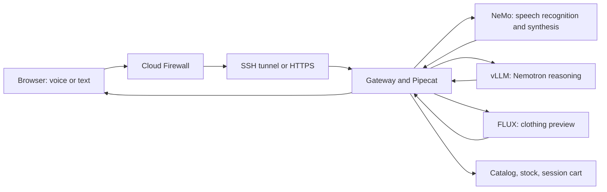

# Akamai Retail Voice Agent

Speak to a retail assistant. It finds products, checks stock, shows a clothing preview, and adds your selection to a demo cart. Speech, reasoning, and image generation run on one Akamai Cloud GPU.

**$300 in free credit for Akamai Cloud.**
[Sign up here](http://login.linode.com/signup?promo=akm-dev-git-300-72326-P153).



Recorded on the Amsterdam GPU. This GIF is silent.

## Try it locally

Install Python 3.12, then:

```bash
git clone https://github.com/akamai-developers/demo--akamai-retail-voice-agent.git
cd demo--akamai-retail-voice-agent
python3.12 scripts/demo.py setup
python3.12 scripts/demo.py run
```

Open <http://localhost:8765>. Copy `TENANT_A_KEY` from `.local/gateway.env` into the sign-in form.

Type `Find a raincoat under $150`, then `Show me the Drizzle Anorak in navy, medium`, then `Add it to my cart`.

Local mode uses fixture replies and a test tone. Real voice and generated try-on previews need the GPU deployment below.

## Cloud prerequisites

- An Akamai Cloud account and an [API token](https://techdocs.akamai.com/cloud-computing/docs/manage-personal-access-tokens) with Linodes and Firewalls read/write access.
- Python 3.12, `make`, `ssh`, `scp`, `ssh-keygen`, and `curl` on your Mac or Linux computer.

The installer handles the GPU driver, Docker, models, and services on the new host. You do not install those on your laptop.

## Deploy to Akamai Cloud

From the cloned repo, read your token without echoing it, then create the settings file:

```bash
read -r -s LINODE_TOKEN   # paste your token and press Enter
export LINODE_TOKEN
make env                 # writes .env with the defaults; preserves existing settings
```

The defaults are one 96 GB RTX PRO 6000 Blackwell in Amsterdam, the fictional try-on person, and access from this computer. Change `LINODE_REGION` in `.env` to choose another region. Add your other computer's IPv4 `/32` address to `ADMIN_CIDR` if needed.

```bash
make gpu-check       # available regions and current prices; creates nothing
make deploy          # review the price, then confirm the new GPU and firewall
make tunnel          # keep this running while you use the browser
```

`make deploy` creates its SSH key, installs the complete site, checks readiness, warms up voice inference, and saves the cloud sign-in key locally. Plan for **45-90 minutes on a first deployment**. This is an estimate, not a measured total; downloads, builds, and scans can take longer. The prior run recorded about 15 minutes for model compilation alone.

The command prints the GPU IP as soon as it is assigned and elapsed time every 30 seconds. When ready, it prints the actual duration, browser URL, and API-key location. Run `make status` to see the saved connection details again. Interrupted runs resume with the same settings.

Open <http://localhost:8766>. In a second terminal:

```bash
make key             # copies the app API key on a Mac; displays the key on Linux
make cloud-check     # checks GPU visibility, service readiness, keys, and retailer isolation
make smoke           # real spoken search, live preview, cart continuity, and sold-out stock
```

Paste the key into the sign-in form and click **Start conversation**. This is the app API key, not your `LINODE_TOKEN`. It is stored privately in `.local/sites/SITE_NAME/shopper-key.txt`. Say:

1. "Find a raincoat under one hundred and fifty dollars."
2. "Show me the Drizzle Anorak in navy medium. Let me try it on."
3. "Looks good. Add it to my cart."

The GPU bills until you delete it. When finished:

```bash
make destroy         # asks for the site label; deletes only that site's GPU and firewall
```

The default browser connection uses SSH, so no domain or certificate is needed. Direct access through a domain requires trusted HTTPS. Plain HTTP at the GPU's IP does not support the microphone. [Deployment details](docs/deploy.md) cover resume, access from another computer, and troubleshooting. [Advanced deployment](docs/deploy-advanced.md) covers TLS and prepared hosts.

## What runs



Each deployment is one independent site. To add a region, use a different site name and region. Functions and automatic site selection belong in a separate repository. The try-on person and catalog are synthetic. Model APIs stay private. See [Architecture](docs/architecture.md).

## Verification and security

The underlying deployment and runtime passed fresh GPU installation, browser, voice, preview, cart, and reboot tests in Amsterdam. [Measured results](docs/fresh-site-verification.md) include a 1.94-second warm voice-response median through SSH.

The new Make commands are tested locally with fake cloud responses, including cancellation, resume, and deletion ownership checks. They have not yet provisioned a new GPU. [Validation](docs/validation.md) distinguishes those checks from the earlier hardware run.

This is a restricted developer demo. Deployment asks you to accept the model licenses and documented unfixed Ubuntu advisories. Dependency and container scans still block known findings. Keys, cloud state, logs, and model files stay outside the public export. See [Security](SECURITY.md) and [Third-party notices](THIRD_PARTY_NOTICES.md).

## Develop

After local setup:

```bash
. .venv/bin/activate
make check           # local tests, formatting, lint, types, and JavaScript checks
make help            # all local and cloud commands
```

[Contributing](CONTRIBUTING.md) covers browser and package checks. [Latency](docs/latency.md) explains how to measure from your presentation location. Source: Apache-2.0; model and asset licenses are listed separately.
