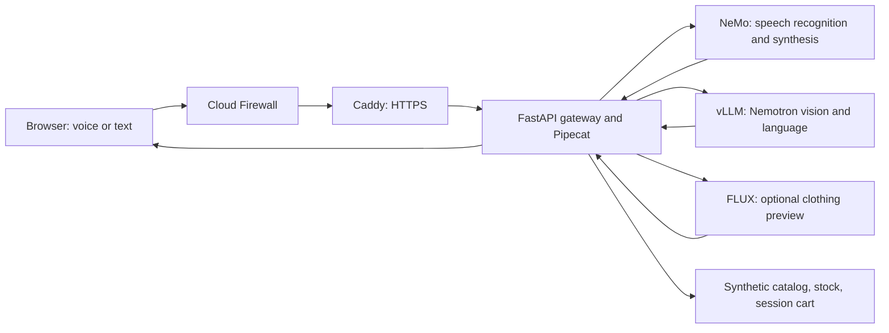

# Akamai Retail Voice Agent

A retail assistant that answers spoken questions, checks stock, and adds items to a session cart. An optional image worker generates a clothing preview using a reference photo you provide.

Run the mock on a Mac or Linux laptop. Deploy real inference to an existing Linux GPU host. The browser, gateway, models, and synthetic catalog run under your control. No hosted inference API key is needed.

## Try it locally

Install Python 3.12, then clone and start the app:

```bash
git clone https://github.com/akamai-developers/demo--akamai-retail-voice-agent.git
cd demo--akamai-retail-voice-agent
python3.12 scripts/demo.py setup
python3.12 scripts/demo.py run
```

Open <http://localhost:8765>. Open `.local/gateway.env` in your editor and paste `TENANT_A_KEY` into the sign-in form. Setup generates different shopper and operator keys for every installation. It preserves them when rerun.

Type: `Find a raincoat under $150.` Then: `Show me the Drizzle Anorak in navy, medium.` Then: `Add it to my cart.`

Mock mode uses deterministic replies and a test tone. It tests the application flow; it does not recognize speech or generate try-on images. Stop it with Ctrl+C.

## Deploy real inference

Follow [Deploy to a GPU host](docs/deploy.md). It covers host prerequisites, one configuration command, model installation, generated systemd services, HTTPS, and verification.

The reference hardware is an NVIDIA RTX PRO 6000 Blackwell with 96 GB VRAM. Do not assume the full stack fits a smaller GPU. Model downloads are large and require explicit license acceptance. No command in this repository provisions a paid server.

The public release updates gateway dependencies. Its fresh GPU installation must be verified on the target host before use in a presentation. [Validation](docs/validation.md) distinguishes local checks from hardware checks.

## What runs



The gateway and model workers share one host. Model ports bind to loopback. The host's region is selected during configuration. Functions-based placement, multi-region routing, BlueField offload, and Guardicore policy deployment are not implemented here. The app's broader architecture presentation labels these extensions separately. See [Architecture](docs/architecture.md).

## Develop

Python dependencies and their hashes are in `requirements.lock.txt`. Node.js 22 or newer is needed only for JavaScript checks.

```bash
. .venv/bin/activate
make check
python -m playwright install chromium
make test-ui test-tryon-ui test-architecture-ui
make test-package
```

Read [Contributing](CONTRIBUTING.md), [Security](SECURITY.md), [latency measurement](docs/latency.md), and [third-party notices](THIRD_PARTY_NOTICES.md). Runtime secrets, models, screenshots, recordings, and personal photos belong in ignored local storage, never in a pull request.
